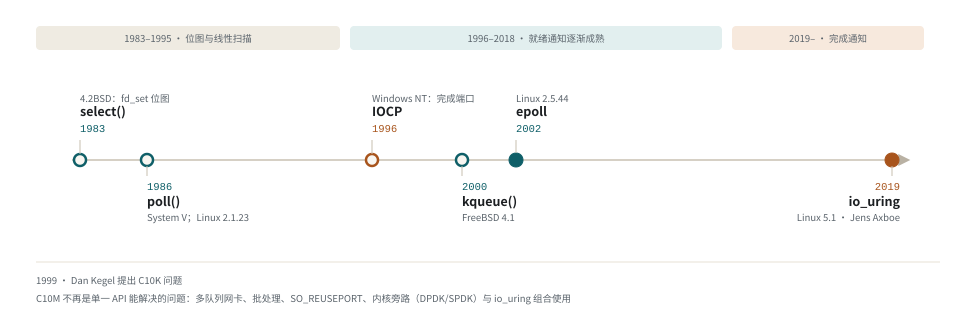

# supermario1990 知识库

基于 Hexo + Fluid 主题的技术知识库，托管在 GitHub Pages：<https://supermario1990.github.io/>

- 源码分支：`hexo`（本分支，日常写作都在这里）
- 发布分支：`main`（Hexo 构建产物，由 `hexo deploy` 推送，不要手改）

## 分支与部署链路

```
hexo 分支（源码：Markdown / 配置 / 主题引用）
      │  hexo generate
      ▼
   public/（静态站点）
      │  hexo deploy（hexo-deployer-git）
      ▼
main 分支根目录 → GitHub Pages 自动发布
```

Pages 的源就是 `main` 分支根目录，所以 **推送 `hexo` 分支不会影响线上**，只有执行 `hexo deploy` 才会更新线上。

## 环境要求

- Node.js ≥ 18（当前用 Node 23 验证）、npm
- 首次进入仓库执行：

```bash
npm install
```

## 新增一篇文章

```bash
npm run new -- "Redis 持久化：RDB 与 AOF 的取舍"
```

会在 `source/_posts/` 下生成 `Redis-持久化：RDB-与-AOF-的取舍.md`。
文件名直接决定 URL，建议手动改成英文短横线形式，例如 `redis-persistence.md`。

### front matter

```yaml
---
title: Redis 持久化：RDB 与 AOF 的取舍
date: 2026-11-20 10:00:00
updated: 2026-11-20 10:00:00
tags:
  - Redis
  - 持久化
categories:
  - 存储
description: 一句话摘要，用于首页卡片摘要与页面 meta description。
eyebrow: 深度技术报告 · STORAGE   # 自定义字段，主题不渲染，保留备查
words: 约 8000 字               # 自定义字段，主题不渲染，保留备查
---
```

- `date` 格式 `YYYY-MM-DD HH:mm:ss`，首页按日期倒序。
- `tags` / `categories` 用 YAML 列表写法，会自动生成 `/tags/`、`/categories/` 聚合页。
- `description` 必写，否则首页卡片没有摘要。
- `eyebrow`、`words` 是旧站点遗留的自定义字段，Fluid 不识别，保留不影响构建。

### 正文

标准 Markdown：`##` / `###` 自动进入侧边栏目录（≥992px）和手机端“目录”折叠块；
表格、围栏代码块（```c）会被主题处理成可横向滚动的容器。

### 图片 / 图示

放在 `source/assets/diagrams/`，正文里用**站点根路径**引用（注意开头的 `/`）：

```markdown

```

## 本地预览

```bash
npm run server       # 等价于 hexo server
```

访问 <http://localhost:4000>。预览是带热更新的动态服务，改完 Markdown 刷新即可。

## 构建与发布

```bash
npm run clean        # 清空 public/
npm run build        # 生成静态站点到 public/
npm run deploy       # 构建并强制推送到 main 分支
```

`npm run deploy` 执行的是 `hexo deploy`（会自动先 generate），它把 `public/` 推到
`git@github.com:supermario1990/supermario1990.github.io.git` 的 `main` 分支。
推送完成后 GitHub Pages 通常 **1 分钟内**重建完成，可在仓库 Settings → Pages 查看状态。

## URL 规则

```yaml
permalink: articles/:title.html
```

即 `source/_posts/epoll-to-io-uring.md` → `https://supermario1990.github.io/articles/epoll-to-io-uring.html`，
与迁移前的老地址完全一致，老链接不会 404。

## 评论

giscus（GitHub Discussions），配置在 `_config.fluid.yml` 的 `giscus` 段：

- repo `supermario1990/supermario1990.github.io`
- repo-id `R_kgDOVwIH1g`
- category `Comments` / category-id `DIC_kwDOVwIH1s4DLPt3`
- mapping `pathname`、lang `zh-CN`

首次在某篇文章下评论时，giscus 会自动在 `Comments` 分类创建对应 Discussion。

## 注意

- 不要手改 `public/` 和 `main` 分支，改 `source/` 后重新构建部署。
- 不要把 `node_modules/`、`public/`、`.deploy_git/` 提交到 `hexo` 分支（已在 `.gitignore` 中忽略）。
