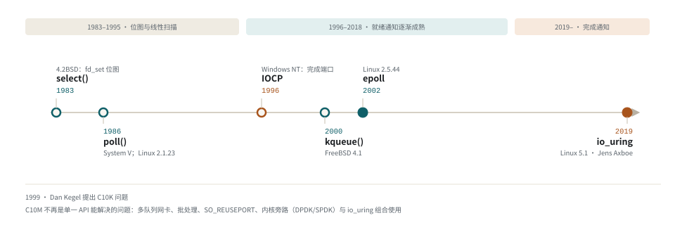
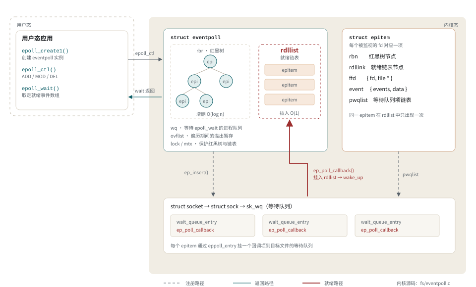
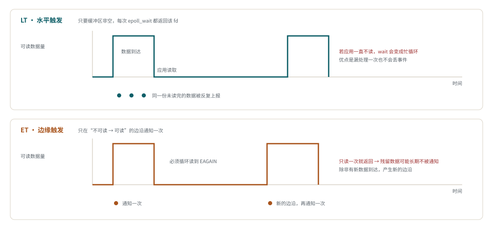
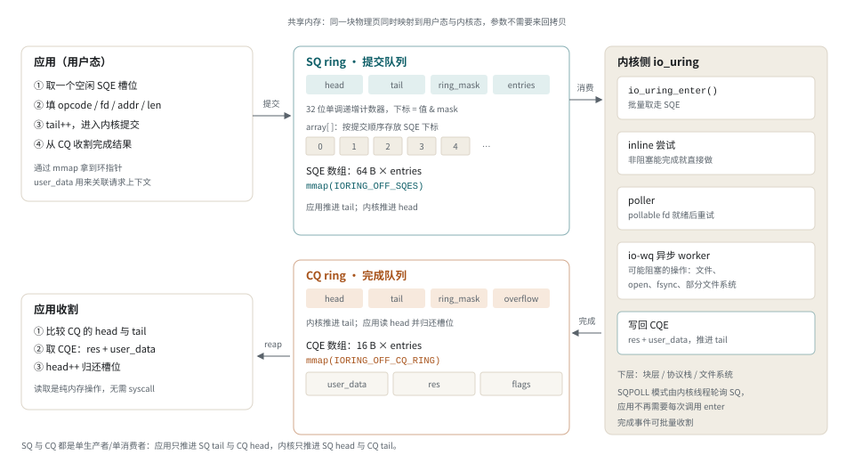
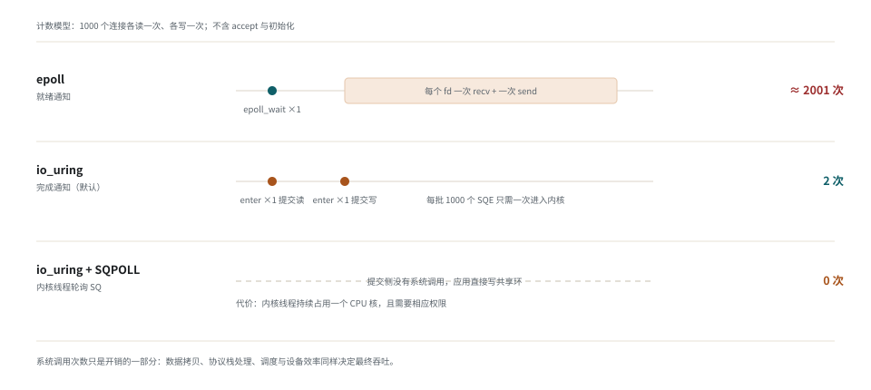
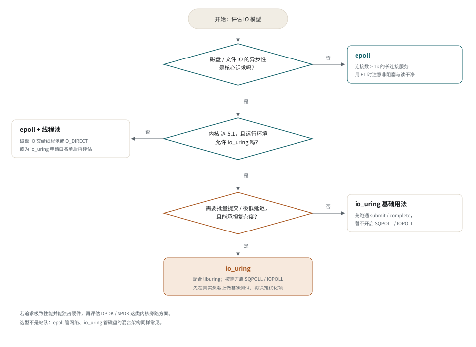

> 同样是“让一个线程处理很多 IO”，两者解决的问题却不在同一个层次：epoll 回答“谁准备好了”，io_uring 回答“这件事什么时候做完”。这篇报告从 select 的位图讲起，拆开两个内核子系统的数据结构与调用路径，解释它们为什么会变成今天这样。


## 00 结论先行

如果只记一句话：**epoll 是“事件就绪通知”，io_uring 是“异步完成通知”。** 前者把“等待”从应用线程里拿走，后者把“执行”也拿走了。

| 层次 | 说明 |
| --- | --- |
| **接口层**（LAYER 1） | epoll_wait 返回的是“哪个 fd 现在可读”；io_uring 返回的是“你之前提交的那个操作做完了，结果在这里”。 |
| **执行层**（LAYER 2） | epoll 下，read/write 仍由应用线程发起；io_uring 下，内核在合适时机执行，应用只提交与收割。 |
| **数据层**（LAYER 3） | epoll 每次都要传缓冲区指针；io_uring 可以注册并固定缓冲区，甚至让内核从预置 buffer 池里挑。 |

| EPOLL · REACTOR | IO_URING · PROACTOR |
| --- | --- |
| **“你的餐好了，来取”**<br>内核监视 fd，状态变化时通知你。你收到通知后，自己去调用 read/write 把数据搬走。通知是廉价的，执行仍是同步的。 | **“订单已收到，做好送到”**<br>你把“要做什么”写进提交队列，内核执行完毕后把结果放进完成队列。提交与完成都走共享内存，覆盖网络与磁盘。 |

> **阅读地图**
> 
> 第 1 章解释“为什么会需要多路复用”，第 2、3 章分别拆开 epoll 与 io_uring 的内核结构，第 4 章给出对照与边界，第 5 章给出可运行代码与选型流程。时间有限的读者可以直接跳到 [4.2 对照表](#matrix) 与 [5.3 选型决策](#choose)。

## 01 背景：为什么需要 IO 多路复用

在 epoll 出现之前，服务器处理并发连接的方式只有两种：一种用更多线程，一种用更少的系统调用。前者把成本压在调度器上，后者把成本压在 CPU 上。多路复用要解决的，是这两笔成本之间的第三条路。

### 1.1 阻塞 IO 与线程模型

Linux 里最朴素的网络读取是 `read(fd, buf, len)`。当 socket 接收队列为空时，这个调用不会立刻返回，而是把当前任务的状态置为可中断睡眠（`TASK_INTERRUPTIBLE`），挂到该 socket 的等待队列上，然后调用调度器让出 CPU。直到网卡收到数据、协议栈把数据放进接收队列并唤醒等待者，线程才重新变成可运行状态。

这个过程本身没有问题，问题在于**“等待”占用了“执行”的资源**。如果一台服务器要同时服务一万个连接，最直接的写法就是每连接一个线程：每个线程大部分时间都在睡眠，但仍然占用内核栈、用户栈（虚拟地址空间）、调度实体和一组寄存器状态。连接数上升时，调度器要管理的实体数量线性上升，上下文切换与缓存失效随之增加。

更麻烦的是，线程模型把“并发度”和“线程数”绑死了。你无法用 4 个核高效地服务 10 万个连接，因为 10 万个线程的调度开销会先压垮系统。**〔定性判断〕** 这也是为什么 Apache 的 prefork 模型在静态文件时代很好用，到了长连接时代就迅速让位给事件驱动模型。

### 1.2 select：位图的三重代价

`select` 诞生于 1983 年的 4.2BSD，思路非常直接：把一组 fd 打包成一个位图（`fd_set`），交给内核，让内核告诉你“这里面哪些已经就绪”。

```c
/* select 的典型用法：每次调用前都要重新构造集合 */
fd_set rfds;
FD_ZERO(&rfds);
FD_SET(sock_a, &rfds);
FD_SET(sock_b, &rfds);
int maxfd = (sock_a > sock_b ? sock_a : sock_b) + 1;

int n = select(maxfd, &rfds, NULL, NULL, NULL);
for (int fd = 0; fd < maxfd; fd++)
    if (FD_ISSET(fd, &rfds)) { /* 还得自己遍历找出来 */ }
```

它的结构性代价可以拆成三层：

- **表示能力受限。**`fd_set` 是一个固定长度的位图，`FD_SETSIZE` 通常是 1024。这意味着 fd 的数值必须小于 1024，且一次最多只能关注 1024 个描述符。这个限制是编译期常量，改它需要重新编译 libc，工程上几乎不可行。
- **数据要来回搬。**每次调用都要把三个位图从用户态拷贝到内核态；返回时内核再把结果位图拷回来。而且内核会*原地修改*传入的集合，所以下一次调用前必须重新 `FD_ZERO` / `FD_SET`。兴趣集合没有被记住，每次都是一次性查询。
- **两次线性扫描。**内核要遍历所有 fd，逐个调用其 `poll` 回调判断状态，是 O(n)；返回后应用还要从 0 遍历到 `maxfd` 找出哪一位被置位，又是一次 O(n)。更糟的是返回值 `n` 只告诉你“有几个就绪”，不告诉你是哪几个。

在几百个连接的年代，这些都是可以接受的开销。但当连接数到几千、几万时，O(n) 的扫描和全量拷贝就成了主要瓶颈：明明只有 3 个连接有数据，内核却要把 10000 个 fd 全查一遍，用户态还要再全扫一遍。

### 1.3 poll：去掉上限，没去掉扫描

`poll` 在 1980 年代由 System V 引入，Linux 从 2.1.23（1997 年）开始支持。它把位图换成了结构体数组：

```c
struct pollfd {
    int   fd;       /* 关注哪个 fd，可以是任意合法值 */
    short events;   /* 输入：我关心什么事件 */
    short revents;  /* 输出：实际发生了什么 */
};
```

这解决了 select 的两个问题：fd 不再受 1024 限制（改为受 `RLIMIT_NOFILE` 约束），输入与输出也分开了，不需要每次重置整个集合。但**模型没有变**：每次调用仍然要把整个数组拷进内核，内核仍然要线性遍历所有 fd，返回后应用仍然要线性遍历结果。

> **关键区别**
> 
> poll 是一次**接口改良**，不是一次**模型改良**。它让“能监视更多 fd”成为可能，但没有让“监视成本”随就绪数而不是总数增长。真正的模型变化要等到 epoll。

### 1.4 epoll：把注册与等待拆开

epoll 由 Davide Libenzi 开发，2002 年进入 Linux 2.5.44。它的核心洞察只有一句话：**兴趣集合是长期存在的，不应该每次调用都重建一遍。**

于是 epoll 把“注册”和“等待”拆成了两组系统调用：`epoll_ctl` 负责往内核里的兴趣集合中增删改，`epoll_wait` 只负责取走“已经就绪”的那部分。兴趣集合常驻内核，用红黑树组织；就绪的 fd 由回调主动挂进一条链表，等待时直接取链表，不需要全量扫描。

这个设计带来的直接结果是：**等待的复杂度从 O(总数) 变成了 O(就绪数)**。一万个空闲连接对 `epoll_wait` 几乎没有成本，因为它们根本不在就绪链表里。这也是 epoll 能支撑 C10K 的根本原因。



| 维度 | select | poll | epoll |
| --- | --- | --- | --- |
| 出现时间 | 1983，4.2BSD | System V；Linux 2.1.23 | Linux 2.5.44（2002） |
| 数据结构 | fd_set 位图 | pollfd 数组 | 内核红黑树 + 就绪链表 |
| fd 数量上限 | FD_SETSIZE（通常 1024） | RLIMIT_NOFILE | max_user_watches |
| 兴趣集合 | 每次调用重建 | 每次调用重建 | 常驻内核，注册一次 |
| 每次调用拷贝 | 全量，双向 | 全量，双向 | 只拷贝就绪事件 |
| 内核扫描 | O(n) | O(n) | O(k)，k 为就绪数 |
| 用户态扫描 | O(n) | O(n) | O(k) |
| 触发模式 | 水平触发 | 水平触发 | 水平 / 边缘触发 |
| 附加能力 | — | — | ET、EPOLLONESHOT、EPOLLEXCLUSIVE |

### 1.5 从 C10K 到 C10M

1999 年，Dan Kegel 在文章中把“单机同时处理一万个连接”明确为一个工程问题，后来被称为 C10K。这个问题在当时并不是“买个更大的机器”能解决的：操作系统层面的 fd 限制、select 的 O(n)、每连接一线程的调度开销，都会在几千连接时集中暴露。epoll 与 kqueue 正是这一轮演进的产物。

到了 C10M（一千万连接），单靠“更好的通知机制”已经不够了。实践中的组合通常是：多队列网卡配合 RSS/RPS 把软中断分散到多个核；`SO_REUSEPORT` 让多个进程各自持有监听 socket；`recvmmsg`/`sendmmsg` 做批量收发；把连接状态压缩到极致；极端场景下用 DPDK/SPDK 把协议栈搬到用户态，直接接管网卡或磁盘。

> **一个容易被忽略的事实**
> 
> epoll 解决的是“通知”的扩展性，它并没有解决“每次读写仍要一次系统调用”和“磁盘 IO 无法真正异步”这两个问题。这两个问题要等到 io_uring 才被正面处理。

## 02 epoll：事件就绪通知

epoll 的天才之处不在于“用了红黑树”，而在于它把“我关心哪些 fd”变成了一份长期驻留内核的注册表，并让数据到达的瞬间由内核主动把 fd 记到一张小纸条上。等待的人只需要看纸条，不需要挨个敲门。

### 2.1 三个接口的语义

epoll 的 API 只有三个调用，理解它们的职责划分，比记住参数更重要：`epoll_create` 建立“实例”，`epoll_ctl` 维护“兴趣集合”，`epoll_wait` 取“就绪结果”。实例是容器，兴趣集合是长期状态，就绪结果是瞬时快照。

| 调用 | 职责 | 需要记住的细节 |
| --- | --- | --- |
| `epoll_create1()` | 创建一个 epoll 实例，返回 epfd | 旧接口的 `size` 参数已被忽略，但仍要求大于 0；新代码用 `EPOLL_CLOEXEC` 避免 fd 泄漏到子进程。 |
| `epoll_ctl()` | ADD / MOD / DEL，增删改兴趣项 | 重复 ADD 返回 `EEXIST`；删除不存在的返回 `ENOENT`；普通文件返回 `EPERM`；不能把自己加进去（`ELOOP`）。 |
| `epoll_wait()` | 等待并取走就绪事件 | `maxevents` 必须大于 0；`timeout` 单位是毫秒，-1 表示无限等待，0 表示立即返回；被信号打断返回 `EINTR`。 |
| `epoll_pwait2()` | 带 `timespec` 超时的版本 | Linux 5.11 起提供，把超时精度从毫秒提升到纳秒，并支持信号掩码。 |

`epoll_event` 里的 `data` 是一个 8 字节的联合体，可以放 fd，也可以放指针。内核**原样保存、原样返回**，不解释它的含义。这个设计让应用可以把“fd 对应哪个连接对象”的映射直接塞进内核，省掉一次查表——这是 epoll 在高并发下仍然好用的一个细节。

### 2.2 内核里的三件套

epoll 的内核实现主要在 `fs/eventpoll.c`。抛开锁与内存管理的细节，它的核心数据结构只有三个：`eventpoll`（实例）、`epitem`（一个被监视的 fd）、`eppoll_entry`（挂在目标文件等待队列上的回调项）。



#### 注册：ep_insert 做了什么

当你调用 `epoll_ctl(EPOLL_CTL_ADD)` 时，内核大致做了五件事：

1. 分配一个 `epitem`，记录 fd、`struct file *`、关注的事件掩码和用户数据。
2. **先检查一次当前是否已经就绪**。这一点很关键：如果 fd 在注册之前就已经可读，回调不会被触发（因为状态没有“变化”），必须在这里补一次检查，把它直接挂进就绪链表。
3. 把 `epitem` 插入 `eventpoll` 的红黑树，键是 `(file, fd)`。插入是 O(log n)。
4. 调用目标文件的 `poll` 回调，把 `eppoll_entry` 挂到目标文件的等待队列上（对 socket 来说就是 `sk_wq`）。
5. 如果第 2 步发现已就绪，把 `epitem` 加入 `rdllist`。

注意第 4 步：**epoll 并没有“轮询” socket**。它只是把自己注册进了 socket 的等待队列，就像在门上装了一个门铃。之后 socket 状态变化时，是 socket 侧主动按铃。

#### 就绪：回调如何做到 O(1)

以 TCP 收数据为例，一条典型路径是：网卡收到包 → 硬中断 → NAPI 轮询 → 协议栈处理 → 数据被放进 socket 接收队列 → 调用 `sk->sk_data_ready()` → 唤醒 `sk_wq` 上的等待者 → 内核遍历等待队列，逐个调用回调，其中就包括 `ep_poll_callback()`。

`ep_poll_callback()` 做的事情极少：检查这个 `epitem` 是否已经在 `rdllist` 里；如果不在，就用链表头插/尾插把它挂进去，然后 `wake_up(&ep->wq)` 唤醒正在 `epoll_wait` 上睡眠的线程。如果已经在链表里，就直接返回，避免重复。

> **为什么这一步是 O(1)**
> 
> 因为它不遍历任何集合，只做一次“是否已挂入”的判断和一次链表插入。真正昂贵的工作（判断 fd 是否可读）发生在数据到达的路径上，由协议栈顺手完成，epoll 只是“搭便车”记录了一个结果。

还有两个实现细节值得知道。**其一是去重**：同一时刻一个 fd 可能在 `rdllist` 里只出现一次，这是 ET 能成立的基础，也是 LT 需要“没读完就放回去”的原因。**其二是溢出链表**：如果 `epoll_wait` 正在遍历 `rdllist` 时又有新事件到达，内核会把它们暂存到 `ovflist`，等本轮遍历结束后再合并，避免遍历过程中链表被修改。

### 2.3 epoll_wait 做了什么

`epoll_wait` 的逻辑可以概括为两段：如果 `rdllist` 为空，就睡在 `ep->wq` 上；如果不为空，就把链表上的事件搬到用户数组里。

搬运过程并不是简单地复制。对链表上的每个 `epitem`，内核会**重新调用一次 poll**，拿到此刻真实的 `revents`，因为从事件被挂入链表到应用取走它之间，状态可能已经变了（数据可能被别的线程读走、对端可能已经关闭）。拿到 `revents` 之后：

- **LT 模式**：如果 `revents` 里仍然包含用户关注的事件，说明还没处理干净，把它重新挂回 `rdllist`，下一次 `epoll_wait` 还会返回它。
- **ET 模式**：不管是否处理干净，都不再挂回。`epitem` 回到红黑树里安静等待下一次状态变化。

这就是 LT 与 ET 的全部实现差异：**不是两套机制，而是“要不要放回就绪链表”这一个分支。**

#### “epoll 是 O(1)”到底在说什么

这句话经常被过度简化。准确的说法是：**就绪事件的收集是 O(1)，等待的返回是 O(k)**，而注册与删除是 O(log n)。它相对于 select/poll 的优势，是把“每次调用都要扫描全部 fd”变成了“只处理已经就绪的 fd”。

| 操作 | 复杂度 | 说明 |
| --- | --- | --- |
| epoll_ctl ADD / DEL | O(log n) | 红黑树插入/删除，n 是注册的 fd 总数 |
| 数据到达时的回调 | O(1) | 判断是否已在链表 + 一次链表插入 |
| epoll_wait 返回 k 个事件 | O(k) | 遍历 rdllist，重新 poll，拷贝到用户态 |
| select / poll 一次调用 | O(n) | 内核扫描全部 fd，用户态再扫描一遍结果 |

所以当连接数很大、活跃比例很低时，epoll 的优势极其明显；而当几乎所有 fd 都活跃时，两者的差距会缩小，epoll 甚至可能因为回调与链表的额外开销而略吃亏。**〔定性判断〕**

### 2.4 LT 与 ET

水平触发（Level Triggered，LT）是默认模式，语义是“**只要条件成立，我就一直告诉你**”。边缘触发（Edge Triggered，ET）需要显式加 `EPOLLET`，语义是“**只在状态发生变化的那一刻告诉你一次**”。

把 fd 想象成一扇门：LT 是“门开着就一直提醒你”，ET 是“门从关到开的那一瞬间提醒你一次”。LT 更宽容，你漏了一次提醒，下次还会得到；ET 更省事，但要求你在被提醒时把该做的事一次做完。



| 维度 | LT（默认） | ET（EPOLLET） |
| --- | --- | --- |
| 通知时机 | 条件成立期间，每次 wait 都可能返回 | 状态变化的那一次，只返回一次 |
| 通知次数 | 可能多于实际需要 | 接近“最少必要” |
| 读写要求 | 可以只读一次，剩下的下次再说 | 必须循环读写到 EAGAIN |
| fd 阻塞模式 | 阻塞或非阻塞都可以 | 必须非阻塞，否则最后一次读会卡死线程 |
| 漏事件风险 | 低 | 实现不当会漏，且很难复现 |
| 适用场景 | 通用服务器、逻辑复杂、读写不频繁 | 高并发、追求减少无效唤醒、能严格控制读写循环 |

#### 为什么 ET 必须搭配非阻塞 fd

ET 要求“一次把能读的都读完”，写法必然是循环：

```c
for (;;) {
    ssize_t n = read(fd, buf, sizeof buf);
    if (n > 0) { /* 处理数据，继续读 */ }
    else if (n == 0) { /* 对端关闭 */ }
    else if (errno == EAGAIN || errno == EWOULDBLOCK) { /* 读干净了，正常退出 */ }
    else if (errno == EINTR) { continue; }
    else { /* 真正的错误 */ }
}
```

如果 fd 是阻塞的，当缓冲区被读空时，最后一次 `read` 不会返回 `EAGAIN`，而是**把当前线程挂起**，直到有新数据到达。对一个单线程事件循环来说，这意味着整个循环停摆：其他几千个连接都得不到处理。**〔最常见的线上事故〕**

同理，ET 模式下监听 socket 的 `accept` 也必须循环到 `EAGAIN`。否则一次只接受一个连接，剩下的已完成连接会留在队列里，而边沿已经消费掉了，可能长时间不再触发。Linux 4.5 之后，监听 socket 在 ET 下的 `accept` 能正确返回 `EAGAIN`。

### 2.5 经典坑与边界

epoll 的接口很小，但语义上的坑不少。以下几条在真实系统里反复出现：

- **ET + 只读一次。**收到可读通知后读了一次就返回，缓冲区里还有残留。因为边沿已经被消费，除非有新数据到达，否则不会再通知——数据就“卡”在缓冲区里。
- **ET + 阻塞 fd。**上一条的加强版：最后一次读直接把线程挂起，整个事件循环停摆。
- **LT + 不读。**每次 `epoll_wait` 都立刻返回同一个 fd，CPU 空转，看起来像“epoll 很耗 CPU”，实际是应用没有消费数据。
- **多线程共享 epfd 且用 ET。**同一个就绪事件可能被两个线程同时拿到，两个线程都去读同一个 socket，数据被拆分到不同线程，业务状态错乱。解决办法是 `EPOLLONESHOT`：事件被取走后自动失能，处理完再 `MOD` 重新武装。
- **accept 惊群。**多个进程/线程阻塞在同一个监听 fd 上，新连接到达时全部被唤醒，只有一个能 accept 成功。`EPOLLEXCLUSIVE`（4.5+）让内核只唤醒一个等待者，但它不保证负载均衡；`SO_REUSEPORT` 是另一种更彻底的方案。
- **fork 之后共享 epfd。**父子进程看到的是同一个 epoll 实例，事件会被两边争抢。通常应该在 fork 后各自重新创建。
- **试图监视普通文件。**`epoll_ctl` 对普通文件返回 `EPERM`。原因是普通文件没有“等待数据到达”的语义，它永远是可读的；而且文件 IO 走 page cache，真正的阻塞发生在缺页与回写上，epoll 管不了。

> **本章小结**
> 
> epoll 把“监视”变成了常驻状态，把“就绪”变成了回调驱动的链表插入，因此等待成本只与就绪数相关。但它始终只解决“通知”：真正的数据搬运仍由应用线程发起，每次读写仍是一次系统调用，磁盘 IO 仍然无法被它变成异步。这两点，正是 io_uring 的出发点。

## 03 io_uring：异步完成通知

如果 epoll 的问题是“每次读写还要一次系统调用”，那么最直接的解法就是：把“要做什么”提前写在一块应用和内核都能看到的内存里，让内核自己取、自己执行、自己填结果。这就是 io_uring 的全部野心——它不是又一个多路复用器，而是一套通用的异步 IO 接口。

### 3.1 syscall 的成本结构

一次系统调用看似只是一条指令，实际包含一串固定开销：保存用户态寄存器、切换到内核栈、校验参数、可能切换页表（KPTI 之后更明显）、执行、恢复现场、返回用户态。如果这次调用还需要睡眠或等待，再加上一次上下文切换。

量级上，一次空系统调用通常在几十到几百纳秒，一次线程上下文切换通常在微秒级。具体数值强烈依赖 CPU 型号、内核配置与安全缓解措施，这里只做定性描述。**〔定性判断〕**

单次成本并不吓人，吓人的是**乘法**。一个每秒处理 100 万次请求的服务，如果每个请求要 4 次系统调用，就是每秒 400 万次陷入内核；而每次陷入还伴随着缓存与 TLB 的扰动。当业务逻辑本身很轻时，系统调用开销会占据相当可观的比例。

还有一个更硬的结构性问题：**普通文件的 read 无法用 epoll 变成异步**。文件描述符在 epoll 里永远“就绪”，而真正的阻塞发生在 page cache 未命中时的磁盘读取、或者写回时的脏页回写。你没法用“等文件可读”的方式等它，因为文件没有这种状态。POSIX AIO（`aio_read` 那一套）在 Linux 上长期只对 O_DIRECT 场景表现尚可，并没有成为通用方案。

### 3.2 共享环形队列

io_uring 的核心是一对环形队列：**提交队列 SQ**（Submission Queue）与 **完成队列 CQ**（Completion Queue）。它们被放在一块由 `mmap` 映射的内存里，用户态和内核态看到的是同一块物理页。应用往里写，内核从里读；反过来，内核往里写，应用从里读。

每个环由四个关键量描述：`head`（消费者位置）、`tail`（生产者位置）、`ring_mask`（取模掩码）、`ring_entries`（槽位数）。head 与 tail 都是 32 位、单调递增的计数器，**不会回绕**；下标通过 `index & ring_mask` 得到。因此槽位数必须是 2 的幂。



三块映射区域的分工如下：

| 映射区域 | offset | 内容 |
| --- | --- | --- |
| SQ ring | `IORING_OFF_SQ_RING` | head / tail / ring_mask / ring_entries / flags / dropped，以及 `array[]` |
| CQ ring | `IORING_OFF_CQ_RING` | head / tail / ring_mask / ring_entries / overflow，以及 CQE 数组 |
| SQE 数组 | `IORING_OFF_SQES` | `entries × 64 B` 的提交项数组 |

SQE 是 64 字节的定长结构，字段按“常用在前、扩展在后”排列；CQE 只有 16 字节，因为完成侧只需要告诉你是谁、结果如何。

**io_uring.h · 结构精简版** · `C`

```c
struct io_uring_sqe {          /* 64 字节，缓存行对齐 */
    __u8  opcode;               /* IORING_OP_READ / WRITE / ACCEPT ... */
    __u8  flags;                /* IOSQE_IO_LINK / IOSQE_FIXED_FILE ... */
    __u16 ioprio;
    __s32 fd;
    __u64 off;                  /* 文件偏移 */
    __u64 addr;                 /* 缓冲区地址或目标结构体 */
    __u32 len;
    union { __u32 rw_flags; __u32 fsync_flags; /* ... */ };
    __u64 user_data;            /* 原样回传，用来关联上下文 */
    union { __u16 buf_index; __u16 personality; /* ... */ };
    /* 其余字段略：buf_group、splice_fd_in、addr3 等 */
};

struct io_uring_cqe {          /* 16 字节 */
    __u64 user_data;
    __s32 res;                  /* 返回值；负数为 -errno */
    __u32 flags;                /* 如 IORING_CQE_F_MORE */
};
```

`user_data` 是整个设计里最实用的一个字段。内核从不解释它，只是把它从 SQE 复制到 CQE。应用可以放指针、放连接 id、放一个自增序号，收割时就能 O(1) 找回对应的请求对象，不需要额外的哈希表。

由于 SQ 与 CQ 各自只有一个生产者，同步被简化到极致：应用在写 SQE 与推进 `tail` 之间插入一个 release 屏障，内核在读 `tail` 与读 SQE 之间插入 acquire 屏障。没有锁，没有原子计数器争用，只有两个方向的单向指针推进。

### 3.3 提交之后发生了什么

应用侧的动作只有四步：取槽位、填 SQE、推进 `tail`、调用 `io_uring_enter(fd, to_submit, min_complete, flags, sig, sz)`。其中 `to_submit` 告诉内核“这次新增了几个”，`min_complete` 表示“顺便等多少个完成再返回”。

进入内核后，路径大致如下：

1. `io_uring_enter` 校验参数，调用 `io_submit_sqes` 批量取出 SQE。
2. 每个 SQE 经过 `io_init_req` 初始化请求对象，再进入 `io_queue_sqe`。
3. **先尝试 inline 执行。**对网络 fd，内核会以非阻塞方式直接尝试一次读或写。如果立刻成功，请求当场完成，直接写 CQE，连 worker 都不用起。
4. **不能立刻完成，就分两种去向。**如果 fd 是可 poll 的（socket、pipe 等），挂到内部的 poll 机制上（poller），等就绪后再重试；如果操作本身可能睡眠（文件读写、open、fsync），交给 `io-wq` 的异步 worker 执行。
5. 完成后填 CQE，推进 CQ `tail`，必要时唤醒正在等待完成的线程。

| 组件 | 负责什么 | 为什么需要它 |
| --- | --- | --- |
| inline 路径 | 在提交上下文里直接尝试非阻塞执行 | 大量网络 IO 其实在提交时就能完成，没必要多一次调度 |
| poller | 把暂时不可用的 pollable fd 挂起，就绪后重试 | 避免为每个空闲 socket 占用一个 worker 线程 |
| io-wq | 真正执行可能阻塞的操作 | 文件系统、open、fsync 等无法在提交上下文里安全睡眠 |
| 完成队列 | 把结果交回应用 | 让“完成”与“提交”解耦，支持批量收割 |

> **一个容易误解的点**
> 
> io_uring 并不是“所有 IO 都由内核线程执行”。网络 IO 的常态是 inline + poller，只有真正可能阻塞的操作才下沉到 io-wq。因此它的线程数并不会随连接数线性增长。

### 3.4 三个关键优化项

io_uring 的很多设计都在做同一件事：**把“每次操作都要重复的准备成本”摊销掉**。下面三项是最常被提及的。

#### IORING_SETUP_SQPOLL：把“提交”也变成无系统调用

默认模式下，应用填完 SQE 仍要调用 `io_uring_enter` 告诉内核“有新活了”。SQPOLL 模式会创建一个内核线程，持续轮询 SQ 的 `tail`；应用只要推进 `tail`，内核线程就会看到并处理，提交侧完全不需要系统调用。

代价很直接：**一个 CPU 核被持续占用**，即使没有 IO 也在空转。创建它还需要相应特权（不同内核版本要求的权能不同，较新版本为 `CAP_SYS_NICE`，早期为 `CAP_SYS_ADMIN`）。**〔版本相关〕** 它适合 IOPS 极高、延迟极敏感、且能接受独占一个核的场景，不适合普通 Web 服务。

#### IORING_SETUP_IOPOLL：用轮询代替中断

块设备完成 IO 通常靠中断通知 CPU。中断本身有开销，且会带来延迟抖动。IOPOLL 让内核主动轮询设备的完成队列，省掉中断路径，适合 NVMe 这类支持多队列轮询的硬件。

它通常要求以 `O_DIRECT` 打开文件，因为走 page cache 时无法保证提交后不阻塞。也就是说，IOPOLL 的收益与“绕过页缓存”是绑定的，不能简单理解为“打开这个开关就更快”。

#### registered files / buffers：把查找与固定也摊销掉

每次提交一个普通请求，内核对 fd 要做一次查找与引用计数，对用户缓冲区要做一次地址校验与固定（pin）。当 IO 很小、频率很高时，这些“准备工作”占比会变得可观。

- **registered files**：预先注册一组 fd，之后提交时用索引代替 fd，省掉每次查找，也避免 fd 被关闭的竞态。
- **registered buffers**：预先注册并固定缓冲区，提交时用 `buf_index` 指定，省掉每次 pin/unpin。
- **provided buffers**：应用预置一批 buffer，内核完成收包时自己挑一个可用的，把 buffer id 写进 CQE 的 flags。适合连接多、单连接流量小的服务，避免为每个连接长期持有大缓冲区。

| 优化项 | 省掉什么 | 代价 / 约束 |
| --- | --- | --- |
| IORING_SETUP_SQPOLL | 提交侧的系统调用 | 独占一个核持续轮询；需要特权 |
| IORING_SETUP_IOPOLL | 完成中断的开销 | 通常要求 O_DIRECT 与支持轮询的设备 |
| registered files | 每次 fget/fput 与引用计数 | fd 生命周期要自己管好，注册表有上限 |
| registered buffers | 每次 pin/unpin 用户页 | 缓冲区必须长期有效，注册有内存锁定量限制 |
| provided buffers | 每连接固定大缓冲区 | 需要维护 buffer 池与归还逻辑 |

### 3.5 每轮提交的 syscall 次数

下面用一个明确的计数模型来对比，而不是给出性能数字：假设有 1000 个连接，每个连接读一次、再写一次，忽略 `accept` 与初始化。



这张图最容易被误读成“io_uring 比 epoll 快 1000 倍”。事实并非如此：系统调用只是总开销的一部分，数据仍要从内核拷贝到用户缓冲区，协议栈仍要逐包处理，设备带宽与队列深度仍然是硬约束。**〔定性判断〕** io_uring 真正改变的是**开销的斜率**——当 IO 数量变大、单个 IO 变小时，它的单位成本更低。

### 3.6 版本、生态与现实约束

io_uring 于 Linux 5.1（2019）引入，此后每个版本都在补齐 opcode 与优化项。网络相关的操作在 5.4 之后逐步完善，multishot recv、provided buffer ring 等能力出现在 5.19 附近，6.x 仍在持续扩展。**〔以 liburing 与内核文档为准〕**

实际工程里几乎不会直接手写原始接口，而是用 **liburing**。它封装了 mmap、屏障、队列推进这些容易写错的细节，并提供 `io_uring_prep_read` 这类语义清晰的辅助函数。代价是：liburing 的版本要与内核能力匹配，老内核上很多新特性不可用。

还有三类常被低估的现实约束：

- **容器与安全策略。**不少容器运行时的默认 seccomp 配置会拦截 `io_uring_setup` / `io_uring_enter`；部分发行版通过 `kernel.io_uring_disabled`（6.6 引入）限制非特权使用。部署前必须确认运行时配置。
- **安全历史。**io_uring 功能面很大，过去几年出现过若干提权与信息泄漏漏洞，这也是部分平台选择默认禁用的原因。它不影响“设计是否正确”，但影响“能否上线”。
- **可观测性与调试。**传统 `strace` 只能看到 `enter`，看不到具体提交了什么；需要专门的工具或内核 tracepoint。出错时定位比 epoll 困难得多。

> **本章小结**
> 
> io_uring 把“提交”和“完成”都搬进了共享内存队列，让内核代替应用执行 IO，并用批处理与注册机制摊薄固定成本。它覆盖网络与磁盘，支持 read/write 之外的 open、accept、fsync、splice 等操作。但它的复杂度、版本依赖与运维约束，也远高于 epoll。

## 04 对比：两种模型的边界

把 epoll 和 io_uring 放在一起比较时，最容易犯的错误是拿“通知机制”去比“执行机制”。它们不在同一个抽象层次上：epoll 是事件循环的底座，io_uring 是一套 IO 运行时。

### 4.1 最本质的区别

一次完整的网络请求，在两种模型下的路径是不一样的。下面把“应用做了什么”和“内核做了什么”分开看：

| EPOLL | IO_URING |
| --- | --- |
| **应用执行，内核只报告**<br>① 内核发现 fd 可读，把 epitem 挂进 rdllist<br> ② epoll_wait 返回“这个 fd 可读了”<br> ③ 应用调用 read()，陷入内核<br> ④ 内核把数据拷贝到应用缓冲区<br> ⑤ 应用继续处理业务 | **内核执行，应用只下单**<br>① 应用把“读这个 fd 到这个缓冲区”写进 SQE<br> ② 内核取走 SQE，在合适时机执行读<br> ③ 数据被放进应用指定的缓冲区<br> ④ 内核把结果写进 CQE<br> ⑤ 应用从 CQ 取结果，直接处理 |

这就是 **Reactor** 与 **Proactor** 的区别。Reactor 模式下，应用负责“发现事件并执行对应操作”；Proactor 模式下，应用负责“发起操作并处理完成结果”。前者把“等待”集中了，后者把“执行”也交出去了。

因此，epoll 的能力边界非常清晰：它能覆盖所有“可以等待就绪”的 fd，但每一次实际读写仍是一次系统调用，缓冲区仍由应用每次传入，磁盘 IO 仍然无法用它变成异步。而 io_uring 覆盖的是“可以被内核执行的操作”，包括 read/write、accept/connect、open/statx、fsync、splice 等等。

> **一句话对照**
> 
> epoll 告诉你“现在可以读了”，读不读、读多少、读到哪里，仍然是你的事；io_uring 让你“把读这件事交出去”，然后在完成队列里告诉你结果。

### 4.2 多维度对照表

| 维度 | epoll | io_uring |
| --- | --- | --- |
| 编程模型 | 就绪通知（Reactor）：事件循环 + 非阻塞读写 | 完成通知（Proactor）：提交请求 + 收割完成 |
| 谁执行 IO | 应用线程调用 read/write | 内核执行；必要时由 io-wq worker 代劳 |
| 一次调用提交多个操作 | 否。wait 一次可返回多个就绪事件，但每个 IO 仍要单独 syscall | 是。一次 enter 可提交任意多个 SQE |
| 网络 IO | 支持，是主要场景 | 支持，含 accept / connect / send / recv / sendmsg 等 |
| 文件与磁盘 IO | 不支持普通文件（EPERM），无法真正异步 | 支持，可覆盖 read/write、open、fsync、statx |
| 是否真正异步 | 否，读写仍是同步调用 | 是，提交与完成解耦 |
| 轮询与中断策略 | 内核侧由中断/唤醒驱动；应用侧阻塞在 wait | 默认 enter 驱动；可选 SQPOLL（提交轮询）、IOPOLL（完成轮询） |
| fd 数量扩展性 | 万级到十万级，受 max_user_watches 与内存约束 | 同量级，受 RLIMIT_NOFILE、ring 大小与注册表上限约束 |
| 每操作开销 | 1 次 wait + 1 次 read（+ 1 次 write） | 摊销到批次；可注册文件/缓冲区进一步降低 |
| 缓冲区管理 | 每次传指针，内核每次校验/拷贝 | 可传指针，也可注册固定，或用 provided buffers 由内核挑选 |
| 超时与取消 | 只有 wait 的超时；无法取消已提交的读 | IORING_OP_TIMEOUT、IORING_OP_ASYNC_CANCEL |
| 操作间依赖 | 无，靠应用状态机串联 | IOSQE_IO_LINK / IOSQE_IO_DRAIN 可表达链式依赖 |
| 成熟度 | 2002 年起，二十多年，几乎无处不在 | 2019 年起，演进快，API 仍在扩展 |
| 内核版本要求 | 2.6 起普遍可用 | 5.1+；网络与高级特性通常要 5.4+ / 5.19+ |
| 调试与可观测性 | strace 直接可见，语义直观 | strace 只能看到 enter，需要专门工具 |
| 容器与安全策略 | 无特殊限制 | 部分 seccomp 配置拦截；有 CVE 历史，部分平台默认禁用 |
| 典型场景 | Web 服务器、网关、长连接推送、Redis 类事件循环 | 存储引擎、数据库、日志/消息队列落盘、高 IOPS 代理 |

### 4.3 收益的真实边界

“io_uring 更快”是一个不完整的判断。更准确的说法是：**当每个 IO 的固定开销占比高、且可以批处理时，io_uring 的收益才明显。**

#### 这些场景，epoll 仍然更合适

- **连接多、每连接流量小、逻辑复杂。**业务状态机才是瓶颈，省下几次 syscall 意义有限，而 epoll 的编程模型更直接。
- **需要跨平台。**BSD/macOS 有 kqueue，语义与 epoll 接近；io_uring 是 Linux 专属。
- **内核或运行环境受限。**老内核、受控容器、默认 seccomp 拦截 io_uring 的环境，强行上马只会增加故障面。
- **团队与生态。**现有框架、tracing、压测工具、故障排查经验都围绕 epoll 建立，迁移成本是真实成本。

#### 这些场景，io_uring 的收益最明显

- **磁盘与文件 IO 密集。**这是 epoll 的结构性盲区，也是 io_uring 最早站稳的地方：存储引擎、数据库 WAL、日志落盘。
- **大批量小 IO。**每秒几十万次 4K 读写时，系统调用的固定成本占比很高，批处理与注册机制能显著摊薄。
- **需要表达操作依赖。**例如“先 fsync 再返回”“读完之后接着写”，用 link 比应用层状态机更自然。
- **需要内核侧并发。**一个应用线程可以同时压满多个 NVMe 队列，而不必为每个设备开线程。
- **专用低延迟场景。**SQPOLL + IOPOLL + 注册缓冲区，配合独占核，可以把抖动压到很低。

> **不要忽略的收益递减**
> 
> 如果单个 IO 很大（例如 1 MB 顺序读），时间主要花在设备传输与内存拷贝上，系统调用占比很低，两种模型的差距会迅速缩小；如果瓶颈在 TLS 加解密或业务计算上，换 IO 模型几乎不会有感知。**〔定性判断〕**

## 05 实践：代码与选型

下面两段代码都刻意省略了错误处理的枝节，只保留最能体现模型差异的部分。第一段展示 epoll ET 的核心循环，第二段展示不经 liburing 的 io_uring 最小可用路径。

### 5.1 epoll ET 服务器核心循环

**epoll_et_server.c · 核心循环** · `C · Linux`

```c
/* 监听 socket 的 bind()/listen() 已省略；它必须是非阻塞的 */
#define _GNU_SOURCE
#include <sys/epoll.h>
#include <sys/socket.h>
#include <fcntl.h>
#include <unistd.h>
#include <errno.h>
#include <stdio.h>
#include <stdint.h>

#define MAX_EVENTS 1024

int main(void)
{
    int lfd = socket(AF_INET, SOCK_STREAM | SOCK_NONBLOCK, 0);
    if (lfd < 0) { perror("socket"); return 1; }

    int epfd = epoll_create1(EPOLL_CLOEXEC);
    if (epfd < 0) { perror("epoll_create1"); return 1; }

    struct epoll_event ev = { .events = EPOLLIN | EPOLLET, .data.fd = lfd };
    if (epoll_ctl(epfd, EPOLL_CTL_ADD, lfd, &ev) < 0) {
        perror("epoll_ctl"); return 1;
    }

    struct epoll_event events[MAX_EVENTS];

    for (;;) {
        int n = epoll_wait(epfd, events, MAX_EVENTS, -1);
        if (n < 0) {
            if (errno == EINTR) continue;
            perror("epoll_wait");
            break;
        }

        for (int i = 0; i < n; i++) {
            int fd = events[i].data.fd;
            uint32_t mask = events[i].events;

            /* EPOLLERR / EPOLLHUP 不需要注册，总会上报 */
            if (mask & (EPOLLERR | EPOLLHUP)) { close(fd); continue; }

            if (fd == lfd) {
                /* ET：必须 accept 到 EAGAIN，否则新连接可能不再触发 */
                for (;;) {
                    int cfd = accept4(lfd, NULL, NULL,
                                      SOCK_NONBLOCK | SOCK_CLOEXEC);
                    if (cfd < 0) {
                        if (errno == EAGAIN || errno == EWOULDBLOCK) break;
                        if (errno == EINTR) continue;
                        break;
                    }
                    struct epoll_event cev = {
                        .events = EPOLLIN | EPOLLET,
                        .data.fd = cfd
                    };
                    if (epoll_ctl(epfd, EPOLL_CTL_ADD, cfd, &cev) < 0)
                        close(cfd);
                }
                continue;
            }

            if (mask & EPOLLIN) {
                char buf[4096];
                /* ET：必须读到 EAGAIN，否则残留数据不会被再次通知 */
                for (;;) {
                    ssize_t r = read(fd, buf, sizeof buf);
                    if (r > 0) continue;              /* 处理 buf[0..r) */
                    if (r == 0) { close(fd); break; }   /* 对端关闭 */
                    if (errno == EINTR) continue;
                    if (errno == EAGAIN || errno == EWOULDBLOCK) break;
                    close(fd);
                    break;
                }
            }
        }
    }
    return 0;
}
```

这段代码里有三个值得对照前文的点：

- 监听 fd 与连接 fd 都带 `EPOLLET`，因此两处都必须循环到 `EAGAIN`。
- 连接 fd 通过 `accept4` 直接带上 `SOCK_NONBLOCK`，避免 ET + 阻塞导致的挂死。
- `events[i].data.fd` 直接就是 fd；真实服务通常会放一个连接对象指针，省掉查找。

注意它的成本结构：**每处理一个连接的一次读，仍然要一次 `read` 系统调用**；如果要回写，还要再一次 `write`。epoll 优化的是“知道谁可读”，不是“读”本身。

### 5.2 io_uring 初始化与提交

下面这段代码不依赖 liburing，直接走 `io_uring_setup` / `io_uring_enter`，目的是把“三个 mmap 区域、两个环、一次提交”显式地展示出来。它省略了 SQ 空间检查、部分提交与完整的错误处理，**生产环境请使用 liburing**。

**io_uring_read.c · 原始接口最小示例** · `C · Linux 5.1+`

```c
#define _GNU_SOURCE
#include <linux/io_uring.h>
#include <sys/mman.h>
#include <sys/syscall.h>
#include <unistd.h>
#include <stdint.h>
#include <string.h>
#include <stdio.h>
#include <fcntl.h>

struct ring {
    int fd;
    unsigned *sq_head, *sq_tail, *sq_mask, *sq_array;
    struct io_uring_sqe *sqes;
    unsigned *cq_head, *cq_tail, *cq_mask;
    struct io_uring_cqe *cqes;
};

static int ring_init(struct ring *r, unsigned entries)
{
    struct io_uring_params p;
    memset(&p, 0, sizeof p);

    r->fd = syscall(__NR_io_uring_setup, entries, &p);
    if (r->fd < 0) return -1;

    size_t sq_sz = p.sq_off.array + p.sq_entries * sizeof(unsigned);
    size_t cq_sz = p.cq_off.cqes + p.cq_entries * sizeof(struct io_uring_cqe);

    char *sq = mmap(NULL, sq_sz, PROT_READ | PROT_WRITE,
                    MAP_SHARED | MAP_POPULATE, r->fd, IORING_OFF_SQ_RING);
    char *cq = mmap(NULL, cq_sz, PROT_READ | PROT_WRITE,
                    MAP_SHARED | MAP_POPULATE, r->fd, IORING_OFF_CQ_RING);
    r->sqes = mmap(NULL, p.sq_entries * sizeof(struct io_uring_sqe),
                   PROT_READ | PROT_WRITE, MAP_SHARED | MAP_POPULATE,
                   r->fd, IORING_OFF_SQES);
    if (sq == MAP_FAILED || cq == MAP_FAILED || r->sqes == MAP_FAILED)
        return -1;

    r->sq_head  = (unsigned *)(sq + p.sq_off.head);
    r->sq_tail  = (unsigned *)(sq + p.sq_off.tail);
    r->sq_mask  = (unsigned *)(sq + p.sq_off.ring_mask);
    r->sq_array = (unsigned *)(sq + p.sq_off.array);
    r->cq_head  = (unsigned *)(cq + p.cq_off.head);
    r->cq_tail  = (unsigned *)(cq + p.cq_off.tail);
    r->cq_mask  = (unsigned *)(cq + p.cq_off.ring_mask);
    r->cqes     = (struct io_uring_cqe *)(cq + p.cq_off.cqes);
    return 0;
}

static struct io_uring_sqe *ring_get_sqe(struct ring *r)
{
    unsigned index = *r->sq_tail & *r->sq_mask;

    r->sq_array[index] = index;        /* array 指向 SQE 槽位 */
    return &r->sqes[index];
}

static int ring_submit(struct ring *r, unsigned nr)
{
    __atomic_store_n(r->sq_tail, *r->sq_tail + nr, __ATOMIC_RELEASE);
    return syscall(__NR_io_uring_enter, r->fd, nr, 0, 0, NULL, 0);
}

static int ring_wait_cqe(struct ring *r, struct io_uring_cqe **out)
{
    for (;;) {
        unsigned head = __atomic_load_n(r->cq_head, __ATOMIC_ACQUIRE);
        unsigned tail = __atomic_load_n(r->cq_tail, __ATOMIC_ACQUIRE);
        if (head != tail) {
            *out = &r->cqes[head & *r->cq_mask];
            return 0;
        }
        if (syscall(__NR_io_uring_enter, r->fd, 0, 1,
                    IORING_ENTER_GETEVENTS, NULL, 0) < 0)
            return -1;
    }
}

int main(void)
{
    struct ring r;
    if (ring_init(&r, 8) < 0) { perror("io_uring_setup"); return 1; }

    int fd = open("/etc/hostname", O_RDONLY);
    if (fd < 0) { perror("open"); return 1; }

    static char buf[4096];

    struct io_uring_sqe *sqe = ring_get_sqe(&r);
    memset(sqe, 0, sizeof *sqe);
    sqe->opcode    = IORING_OP_READ;
    sqe->fd        = fd;
    sqe->addr      = (uint64_t)(uintptr_t)buf;
    sqe->len       = sizeof buf;
    sqe->off       = 0;
    sqe->user_data = 0x1234;           /* 完成时原样返回 */

    if (ring_submit(&r, 1) < 0) { perror("io_uring_enter"); return 1; }

    struct io_uring_cqe *cqe;
    if (ring_wait_cqe(&r, &cqe) < 0) { perror("wait_cqe"); return 1; }

    if (cqe->res < 0)
        fprintf(stderr, "read failed: %d\n", cqe->res);
    else
        printf("read %d bytes, user_data=%#llx\n",
               cqe->res, (unsigned long long)cqe->user_data);

    *r.cq_head = *r.cq_head + 1;       /* 归还 CQE 槽位 */
    return 0;
}
```

可以看到，原始接口的“仪式感”很强：手工 mmap、手工取下标、手工维护 head/tail、手工处理内存屏障。这也是 liburing 存在的意义。同样的功能用它写出来只有几行：

**liburing 等价写法** · `C`

```c
struct io_uring ring;
io_uring_queue_init(256, &ring, 0);

struct io_uring_sqe *sqe = io_uring_get_sqe(&ring);
io_uring_prep_read(sqe, fd, buf, sizeof buf, 0);
io_uring_submit(&ring);

struct io_uring_cqe *cqe;
io_uring_wait_cqe(&ring, &cqe);
/* 使用 cqe->res，然后归还 */
io_uring_cqe_seen(&ring, cqe);
```

两段代码放在一起，差异是模型层面的：epoll 版本里，数据是被 `read` 主动“拉”回来的；io_uring 版本里，应用只描述“我要读什么”，数据被内核“推”进缓冲区，应用再消费完成事件。

### 5.3 选型决策

下面的流程图不是绝对规则，而是一个可以快速收敛的提问顺序。先问瓶颈在哪里，再问环境是否允许，最后问团队能否承担复杂度。



#### 一个实用的混合架构

很多系统并不需要二选一。一种常见的分工是：**网络层继续用 epoll**，因为连接多、单连接流量小、逻辑复杂；**存储层用 io_uring**，因为这里才有“真正异步”的收益。两层之间通过无锁队列或批量交接传递请求，既保留了成熟的事件循环，又在磁盘侧拿到了批量与异步。

### 5.4 已知代价与风险

| 代价 | 具体表现 | 缓解方式 |
| --- | --- | --- |
| 内核版本 | 5.1 起步，很多能力要 5.4 / 5.19 甚至 6.x | 用 liburing 屏蔽差异；在编译期与运行期做能力探测 |
| 发行版差异 | 企业发行版内核可能较旧，或关闭了相关配置 | 容器镜像自带内核参数检查；准备 epoll 回退路径 |
| 容器与 seccomp | 默认策略可能拦截 io_uring 系统调用 | 调整 seccomp profile，或在受控环境内使用 |
| 安全面 | 功能面大，历史上有提权与信息泄漏漏洞 | 跟进内核更新；限制非特权使用；最小化注册资源 |
| 编程复杂度 | 请求生命周期、缓冲区所有权、取消与超时都要自己管 | 用 liburing 的高层封装；先做小范围试点 |
| 调试难度 | strace 看不到 SQE 内容，问题定位链路长 | 应用侧埋点 user_data；使用内核 tracepoint 与专用工具 |
| 生态兼容 | 部分运行时、监控与性能工具对 io_uring 支持不完整 | 先在离线服务或存储组件中落地，再逐步推广 |

> **本章小结**
> 
> epoll 的核心循环短小直接，代价是每次 IO 一次系统调用；io_uring 把提交与完成都变成共享内存操作，代价是初始化、生命周期管理与环境依赖。选型的关键不是“谁更新”，而是“瓶颈是否落在它擅长的那一段”。

## 06 附录

### 6.1 六个常见误解

| 误解 | 更准确的说法 |
| --- | --- |
| “epoll 是 O(1) 的” | 就绪事件的**收集**是 O(1)，返回 k 个事件是 O(k)，注册与删除是 O(log n)。它相对 select/poll 的优势是“不再全量扫描”。 |
| “ET 一定比 LT 快” | ET 减少了重复通知，但把“读干净”的责任交给了应用。通知次数不等于 CPU 时间；实现不当的 ET 会更慢、更容易出错。 |
| “io_uring 一定更快” | 收益取决于 IO 大小、队列深度、是否批处理、是否注册缓冲区。单个大 IO 或低队列深度时，差距可能很小。 |
| “epoll 可以监听普通文件” | 普通文件没有“等待数据到达”的语义，`epoll_ctl` 会返回 `EPERM`。文件 IO 的异步要靠 io_uring 或线程池。 |
| “io_uring 完全没有系统调用” | 初始化、注册文件/缓冲区、默认模式下的提交都需要系统调用。只有 SQPOLL 才让提交侧接近零系统调用，但代价是独占一个核。 |
| “io_uring 是 epoll 的替代品” | 两者解决不同层次的问题。io_uring 也能做就绪通知（`IORING_OP_POLL_ADD`），但那只是它的一个 opcode，不是它的模型核心。 |

### 6.2 术语表

| 术语 | 含义 |
| --- | --- |
| Reactor | 事件循环检测就绪事件，再分发给处理器执行实际 IO 的模型。 |
| Proactor | 应用发起异步操作，由内核执行，完成后通知应用的模型。 |
| LT / ET | 水平触发 / 边缘触发。前者在条件持续成立期间反复通知，后者只在状态变化时通知一次。 |
| eventpoll | epoll 实例的内核结构，持有红黑树、就绪链表与等待队列。 |
| epitem | 一个被监视 fd 对应的内核对象，同时是红黑树节点与就绪链表节点。 |
| rdllist | 就绪链表。回调把就绪的 epitem 挂进来，epoll_wait 从这里取事件。 |
| SQE / CQE | 提交队列项（64 B）/ 完成队列项（16 B）。 |
| SQ / CQ | 提交队列 / 完成队列，位于用户态与内核态共享的内存中。 |
| io-wq | io_uring 的异步 worker 池，执行可能阻塞的操作。 |
| poller | io_uring 内部对 pollable fd 的就绪等待机制，就绪后重试请求。 |
| SQPOLL | 由内核线程轮询 SQ，省掉提交侧系统调用的模式。 |
| IOPOLL | 以轮询方式收割块设备完成事件，避开中断开销。 |
| page cache | 内核页缓存。文件读写默认经过它，缺页时会阻塞。 |
| O_DIRECT | 绕过 page cache 的直接 IO 方式，常用于数据库与 IOPOLL 场景。 |
| C10K / C10M | 单机一万 / 一千万并发连接的工程问题代称。 |

### 6.3 延伸阅读

- Linux man-pages：`epoll(7)`、`epoll_ctl(2)`、`epoll_wait(2)`，接口语义的第一手资料。
- Linux man-pages：`io_uring_setup(2)`、`io_uring_enter(2)`、`io_uring_register(2)`。
- 内核源码：`fs/eventpoll.c` 与 `io_uring/` 目录，配合 tracepoint 阅读效果更好。
- Jens Axboe，《Efficient IO with io_uring》：设计动机与早期接口的权威说明。
- liburing 仓库中的 `examples/`：比文档更直观的用法示例。
- Dan Kegel，《The C10K problem》：理解问题起源的历史文档。

> **关于准确性**
> 
> 本文涉及的内核结构名、字段职责与调用路径，以 Linux 5.x 主线实现为参考，做了必要简化；不同版本之间字段与内部机制可能调整。文中所有性能相关表述均为定性判断，不构成基准测试结论。具体行为请以目标内核版本的源码与 man 手册为准。

## 参考资料

1. Linux man-pages, epoll(7). epoll 的接口语义、LT/ET 行为与常见错误。 — [man7.org/linux/man-pages/man7/epoll.7.html](https://man7.org/linux/man-pages/man7/epoll.7.html)
2. Linux man-pages, io_uring_setup(2). 环形队列、mmap 偏移与 setup flags。 — [man7.org/linux/man-pages/man2/io_uring_setup.2.html](https://man7.org/linux/man-pages/man2/io_uring_setup.2.html)
3. Jens Axboe, Efficient IO with io_uring. 设计动机、SQE/CQE 布局与优化项说明。 — [kernel.dk/io_uring.pdf](https://kernel.dk/io_uring.pdf)
4. liburing, GitHub. 官方封装库与 examples 目录。 — [github.com/axboe/liburing](https://github.com/axboe/liburing)
5. Linux kernel documentation. 内核文档与 io_uring 相关说明。 — [docs.kernel.org/](https://docs.kernel.org/)
6. Dan Kegel, The C10K problem. 高并发服务器问题的历史梳理。 — [www.kegel.com/c10k.html](http://www.kegel.com/c10k.html)
